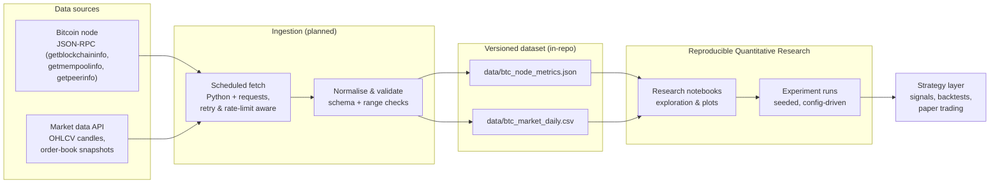

# AI Algorithmic Trading Starter

**An open-source toolkit for building, backtesting and reproducing AI-driven algorithmic trading strategies on live Bitcoin node and market data.**

[](https://github.com/virtualtradrs/ai-algo-trading-starter/actions/workflows/ci.yml)
[](LICENSE)
[](https://www.python.org/downloads/)
[](https://github.com/virtualtradrs/ai-algo-trading-starter/commits/main)
[](https://github.com/virtualtradrs/ai-algo-trading-starter/issues)
[](https://github.com/virtualtradrs/ai-algo-trading-starter/stargazers)

---

## Why this exists

Most algorithmic trading repositories are a single notebook that imports a CSV nobody can find, alongside a backtest with no recorded parameters. You can read the code, but you cannot reproduce the result — and you cannot tell whether the strategy was ever run on anything except a hand-picked slice of history.

This project is the opposite of that. It is a **reproducible starting point for AI algorithmic trading**: the data comes in through a scheduled, versioned pipeline; the dataset lives in the repository as plain JSON and CSV; and every research artifact is driven by a config file you can re-run. Clone it and you have the same inputs, the same seeds and the same code path as everyone else.

The two goals, in order:

1. **Reproducibility.** If a result cannot be regenerated by a stranger from a clean clone, it does not count.
2. **Honesty.** No invented benchmarks, no accuracy percentages lifted from nowhere, no "trusted by" logos. Numbers in this repo are measured, and anything that has not been built yet is labelled as planned.

> **Project status:** the repository scaffolding, documentation and CI health check are live today. The scheduled data pipeline, the versioned dataset and the research notebooks are the next milestone — every section below marks clearly whether it **exists now** or is **planned**. See [Roadmap](#roadmap).

---

## Architecture

The design goal is a straight line from raw data to a strategy you can trust, with every hop inspectable:



**How to read this:** sources → ingestion → dataset → research → strategy. The ingestion and dataset stages are labelled *planned* because they are the next milestone; the arrows are the interface contract the pipeline will implement, so notebooks and strategies can already be written against stable file paths and column names.

---

## How it works

*(Planned — ships in the follow-up pipeline commit. This section describes the design, not something you can run right now.)*

A GitHub Actions workflow runs on a daily schedule. In one job it:

1. **Connects to a Bitcoin node over JSON-RPC** and records node-level telemetry — chain height, mempool size, peer count, verification progress — into `data/btc_node_metrics.json`.
2. **Pulls market data** (daily OHLCV candles) from a public market data API and appends a row to `data/btc_market_daily.csv`.
3. **Validates** the payload against the declared schema before it is allowed to touch a tracked file: required fields present, timestamps monotonic, no nulls in numeric columns, values inside sane ranges.
4. **Commits the updated dataset** with a machine-written message that names what changed and how many rows arrived.

Because the raw data lands in the repository, history is byte-addressable: a research result is reproducible against the exact dataset revision it was produced from. If a fetch fails, the job fails and the last good dataset stays put — a red run, not a silently empty file. The daily job is also expected to do useful work at the moment it runs — it publishes real data. It does not exist to make a contribution graph look busy.

---

## Bitcoin Nodes and market data

The pipeline has two independent feeds and joins them only where a strategy actually needs both.

| Feed | Source | Format | Granularity | Status |
| --- | --- | --- | --- | --- |
| Node telemetry | Bitcoin Core node, JSON-RPC | JSON (one document per run) | Daily snapshot | Planned |
| Market prices | Public exchange/market-data API | CSV (append-only) | Daily OHLCV candle | Planned |

Node telemetry is interesting for algorithmic trading because it is *not* price: mempool congestion, peer count and chain state move for their own reasons, and that makes them a genuinely different signal family from OHLCV. Whether they carry predictive information is exactly the kind of question this repository exists to test honestly — and the answer may well be no.

**Do not hand-edit `data/`.** Those files are generated by CI and any manual change will be overwritten on the next run. See [CONTRIBUTING.md](CONTRIBUTING.md#the-dataset-is-generated-by-ci).

---

## Machine Learning strategy layer

*(Planned.)* The strategy layer is deliberately kept last, and deliberately thin. It consumes the versioned dataset, produces signals, and evaluates them — with the boring machinery that makes results believable:

- **No look-ahead.** Features are computed from information available at or before the decision timestamp; the backtest engine enforces this instead of trusting the author.
- **Explicit costs.** Fees and slippage are parameters of the experiment, not afterthoughts.
- **Seeded and config-driven.** One config file per experiment, seed recorded in the output, run derived from a dataset revision.
- **Baselines first.** A strategy is reported against buy-and-hold and a simple momentum baseline before any model is called an improvement.

Baselines and evaluation come before modelling on purpose: a crossover that ties buy-and-hold after costs is a useful finding, and reporting it is more valuable than hiding it.

---

## Showcase

A short screen recording — the daily dataset diff, a notebook run from a clean clone to a chart, and one strategy evaluated against its baselines — is being produced and will be dropped in here.

<!-- TODO: replace with demo.gif -->
<!--

-->

*Demo coming soon. No placeholder image is embedded on purpose — what you see here will be real output from this repository.*

---

## Quickstart

*(This is runnable today.)*

```bash
git clone https://github.com/virtualtradrs/ai-algo-trading-starter.git
cd ai-algo-trading-starter

python3 -m venv .venv
source .venv/bin/activate            # Windows: .venv\Scripts\activate

pip install -r requirements.txt
```

Run the repository health check — the same script CI runs on every push:

```bash
python scripts/check_repo.py
```

It verifies that the community files, CI configuration and README structure are all present and wired up, then exits non-zero with a readable list if anything is missing.

**Once the pipeline lands**, fetching the dataset becomes a local one-liner as well (the entrypoint is tracked in the [roadmap](#roadmap)), and the notebooks under `notebooks/` will run against the checked-in `data/` files without network access.

### Repository layout

```
.
├── .github/
│   ├── ISSUE_TEMPLATE/       # bug report, feature request, good first issue
│   ├── workflows/ci.yml      # repository health check (runs on every push/PR)
│   └── dependabot.yml        # weekly, grouped dependency updates
├── data/
│   └── README.md             # dataset contract & schema (files are CI-generated)
├── scripts/
│   └── check_repo.py         # the health check described above
├── CODE_OF_CONDUCT.md
├── CONTRIBUTING.md
├── LICENSE
├── README.md
└── requirements.txt
```

---

## Reproducible Quantitative Research

*(Planned: `notebooks/`, `experiments/`.)* Research in this repository follows one rule — **config in, artifact out**:

```
experiments/<name>/config.yaml   →   experiments/<name>/results/*.json
```

Each run records the dataset revision it read, the config it was given, the seed it used and the metrics it produced. A notebook is for exploring; a result you want to keep is promoted into an experiment directory so it can be re-run, diffed and cited. Paths are stable, so a notebook written today keeps working when the pipeline lands.

---

## Contributing

Contributions are welcome, and the process is short:

- Read [CONTRIBUTING.md](CONTRIBUTING.md) for local setup, branch naming and commit style (Conventional Commits).
- New here? Look for issues labelled [`good first issue`](https://github.com/virtualtradrs/ai-algo-trading-starter/labels/good%20first%20issue) — they are scoped to be finishable in a sitting, with the exact files to touch listed in the issue.
- Everything else — bug reports, feature requests, documentation — goes through the [issue templates](https://github.com/virtualtradrs/ai-algo-trading-starter/issues/new/choose).
- Participation is governed by our [Code of Conduct](CODE_OF_CONDUCT.md).

### Good first issues

The repository maintains a standing set of entry points: improving dataset validation, adding a baseline strategy, writing a notebook that reproduces a published result, and tightening the docs. If you are unsure where to start, open an issue asking for a tour — a maintainer will point you at a specific file.

---

## Roadmap

| Milestone | What lands | Status |
| --- | --- | --- |
| M0 — Foundation | README, LICENSE, CONTRIBUTING, Code of Conduct, issue templates, Dependabot, CI health check | **Done** |
| M1 — Data pipeline | Scheduled fetch (Bitcoin node RPC + market API), schema validation, committed daily dataset | Planned |
| M2 — Research | Notebooks, experiment runner, baseline strategies and evaluation harness | Planned |
| M3 — Strategy | Signal generation, cost-aware backtests, paper-trading adapter | Planned |

---
## License

Released under the [MIT License](LICENSE) © Virtual Traders.
