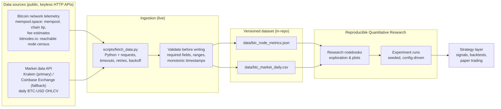

# AI Algorithmic Trading Starter

**An open-source toolkit for building, backtesting and reproducing AI-driven algorithmic trading strategies on live Bitcoin network telemetry and public market data.**

[](https://github.com/virtualtradrs/ai-algo-trading-starter/actions/workflows/ci.yml)
[](LICENSE)
[](https://www.python.org/downloads/)
[](https://github.com/virtualtradrs/ai-algo-trading-starter/commits/main)
[](https://github.com/virtualtradrs/ai-algo-trading-starter/issues)
[](https://github.com/virtualtradrs/ai-algo-trading-starter/stargazers)

---

## Why this exists

Most algorithmic trading repositories are a single notebook that imports a CSV nobody can find, alongside a backtest with no recorded parameters. You can read the code, but you cannot reproduce the result — and you cannot tell whether the strategy was ever run on anything except a hand-picked slice of history.

This project is the opposite of that. It is a **reproducible starting point for AI algorithmic trading**: the data comes in through a scheduled, versioned pipeline; the dataset lives in the repository as plain JSON and CSV; and every research artifact is driven by a config file you can re-run. Clone it and you have the same inputs, the same seeds and the same code path as everyone else.

The two goals, in order:

1. **Reproducibility.** If a result cannot be regenerated by a stranger from a clean clone, it does not count.
2. **Honesty.** No invented benchmarks, no accuracy percentages lifted from nowhere, no "trusted by" logos. Numbers in this repo are measured, and anything that has not been built yet is labelled as planned.

> **Project status:** the repository scaffolding, the documentation, the CI health check and the daily data pipeline are live today — a scheduled GitHub Actions job fetches Bitcoin network telemetry (mempool.space, bitnodes.io) and BTC-USD market data, validates it, and commits the updated dataset to `data/`. The research notebooks and the strategy layer are the next milestone; every section below marks clearly whether it **exists now** or is **planned**. See [Roadmap](#roadmap).

---

## Architecture

The design goal is a straight line from raw data to a strategy you can trust, with every hop inspectable:



**How to read this:** sources → ingestion → dataset → research → strategy. Ingestion and the dataset are *live* today; the research and strategy stages are labelled *planned* because they are the next milestone. The arrows are the interface contract the pipeline implements, so notebooks and strategies can be written against stable file paths and column names.

---

## How it works

*(Live. This is what the code in this repository does today.)*

A GitHub Actions workflow (`.github/workflows/auto-update.yml`) runs once a day, and `scripts/fetch_data.py` does all of the work in one process:

1. **Fetches Bitcoin network telemetry** from public, keyless HTTP APIs into `data/btc_node_metrics.json`, one entry per UTC date:
   - `mempool.space` `/api/mempool` — mempool transaction count, vsize and total fees
   - `mempool.space` `/api/blocks/tip/height` — chain tip height
   - `mempool.space` `/api/v1/fees/recommended` — fee estimates in sat/vB
   - `bitnodes.io` `/api/v1/snapshots/latest/` — the census of reachable Bitcoin **nodes**, which is the "Bitcoin Nodes" half of the project
2. **Pulls market data** — daily BTC-USD OHLCV candles — from Kraken's public OHLC endpoint, falling back to Coinbase Exchange if Kraken is unavailable, and appends only the days that have closed to `data/btc_market_daily.csv`. The in-progress UTC day is deliberately not written: an unfinished candle is not a daily bar.
3. **Validates before writing**, so bad data can never reach a tracked file: required fields present, no nulls in numeric fields, timestamps strictly increasing and unique, every value inside a declared sane range, and the chain tip cross-checked against the node-census height. Validation failure exits non-zero and *no tracked file is modified* — a red run leaves the last good dataset exactly as it was. Files are written atomically and never empty or partial.
4. **Commits the updated dataset** with a message naming what actually changed, e.g. `data: btc node + market snapshot 2026-10-13 (height 971311, mempool 37.9 MB, no new candles)`. If the files are byte-identical to what is already committed, the workflow commits nothing at all.

**We do not run a Bitcoin Core node, and this repository never speaks JSON-RPC to one.** Every number above comes from the named public APIs. When a source is unavailable the run degrades honestly instead of inventing a value: if `bitnodes.io` cannot be reached, the chain and market data are still recorded, the snapshot simply carries no `node_network` block, and both the validation and the commit message say so.

Because the raw data lands in the repository, history is byte-addressable: a research result is reproducible against the exact dataset revision it was produced from. The daily job is also expected to do useful work at the moment it runs — it publishes real data. It does not exist to make a contribution graph look busy.

---

## Bitcoin Nodes and market data

The pipeline has two independent feeds and joins them only where a strategy actually needs both.

| Feed | Source | Format | Granularity | Status |
| --- | --- | --- | --- | --- |
| Chain & mempool telemetry | `mempool.space` — `/api/mempool`, `/api/blocks/tip/height`, `/api/v1/fees/recommended` | JSON, one entry per UTC date | Daily snapshot, refreshed in place on a same-day re-run | Live |
| Bitcoin node census | `bitnodes.io` — `/api/v1/snapshots/latest/` | folded into the same JSON document | Per bitnodes crawl round (hours) | Live, best effort |
| Market prices | `Kraken` `/0/public/OHLC` (Coinbase Exchange `/products/BTC-USD/candles` as fallback) | CSV (append-only) | Closed UTC daily candles | Live |

Node telemetry is interesting for algorithmic trading because it is *not* price: mempool congestion, the reachable node count and chain state move for their own reasons, and that makes them a genuinely different signal family from OHLCV. Whether they carry predictive information is exactly the kind of question this repository exists to test honestly — and the answer may well be no.

**Do not hand-edit `data/`.** Those files are generated by CI and any manual change will be overwritten on the next run. See [CONTRIBUTING.md](CONTRIBUTING.md#the-dataset-is-generated-by-ci).

---

## Machine Learning strategy layer

*(Planned.)* The strategy layer is deliberately kept last, and deliberately thin. It consumes the versioned dataset, produces signals, and evaluates them — with the boring machinery that makes results believable:

- **No look-ahead.** Features are computed from information available at or before the decision timestamp; the backtest engine enforces this instead of trusting the author.
- **Explicit costs.** Fees and slippage are parameters of the experiment, not afterthoughts.
- **Seeded and config-driven.** One config file per experiment, seed recorded in the output, run derived from a dataset revision.
- **Baselines first.** A strategy is reported against buy-and-hold and a simple momentum baseline before any model is called an improvement.

Baselines and evaluation come before modelling on purpose: a crossover that ties buy-and-hold after costs is a useful finding, and reporting it is more valuable than hiding it.

---

## Showcase

A short screen recording — the daily dataset diff, a notebook run from a clean clone to a chart, and one strategy evaluated against its baselines — is being produced and will be dropped in here.

<!-- TODO: replace with demo.gif -->
<!--

-->

*Demo coming soon. No placeholder image is embedded on purpose — what you see here will be real output from this repository.*

---

## Quickstart

*(This is runnable today.)*

```bash
git clone https://github.com/virtualtradrs/ai-algo-trading-starter.git
cd ai-algo-trading-starter

python3 -m venv .venv
source .venv/bin/activate            # Windows: .venv\Scripts\activate

pip install -r requirements.txt
```

Run the repository health check — the same script CI runs on every push:

```bash
python scripts/check_repo.py
```

It verifies that the community files, CI configuration and README structure are all present and wired up, then exits non-zero with a readable list if anything is missing.

Fetching the dataset yourself is one command — it needs only `requests`:

```bash
python scripts/fetch_data.py --dry-run   # print exactly what a run would write; touch no files
python scripts/fetch_data.py             # fetch live data, validate, update data/
```

The notebooks under `notebooks/` (planned — see [Roadmap](#roadmap)) will run against the checked-in `data/` files without network access.

### Repository layout

```
.
 .github/
   ├── ISSUE_TEMPLATE/            # bug report, feature request, good first issue
   ├── workflows/ci.yml           # repository health check (push / pull request)
   ├── workflows/auto-update.yml  # daily scheduled data fetch, validate and commit
   └── dependabot.yml             # weekly, grouped dependency updates
 data/
   ├── README.md                  # dataset contract & schema
   ├── btc_node_metrics.json      # generated: daily chain + node-network snapshots
   └── btc_market_daily.csv       # generated: closed daily BTC-USD candles
 scripts/
   ├── check_repo.py              # the health check described above
   └── fetch_data.py              # the fetcher described above
 CODE_OF_CONDUCT.md
 CONTRIBUTING.md
 LICENSE
 README.md
 requirements.txt
```

---

## Reproducible Quantitative Research

*(Planned: `notebooks/`, `experiments/`.)* Research in this repository follows one rule — **config in, artifact out**:

```
experiments/<name>/config.yaml   →   experiments/<name>/results/*.json
```

Each run records the dataset revision it read, the config it was given, the seed it used and the metrics it produced. A notebook is for exploring; a result you want to keep is promoted into an experiment directory so it can be re-run, diffed and cited. Paths are stable, so a notebook written today keeps working when the pipeline lands.

---

## Contributing

Contributions are welcome, and the process is short:

- Read [CONTRIBUTING.md](CONTRIBUTING.md) for local setup, branch naming and commit style (Conventional Commits).
- New here? Look for issues labelled [`good first issue`](https://github.com/virtualtradrs/ai-algo-trading-starter/labels/good%20first%20issue) — they are scoped to be finishable in a sitting, with the exact files to touch listed in the issue.
- Everything else — bug reports, feature requests, documentation — goes through the [issue templates](https://github.com/virtualtradrs/ai-algo-trading-starter/issues/new/choose).
- Participation is governed by our [Code of Conduct](CODE_OF_CONDUCT.md).

### Good first issues

The repository maintains a standing set of entry points: improving dataset validation, adding a baseline strategy, writing a notebook that reproduces a published result, and tightening the docs. If you are unsure where to start, open an issue asking for a tour — a maintainer will point you at a specific file.

---

## Roadmap

| Milestone | What lands | Status |
| --- | --- | --- |
| M0 — Foundation | README, LICENSE, CONTRIBUTING, Code of Conduct, issue templates, Dependabot, CI health check | **Done** |
| M1 — Data pipeline | Scheduled fetch of Bitcoin network telemetry + BTC-USD candles, validation, committed daily dataset (`scripts/fetch_data.py`, `.github/workflows/auto-update.yml`) | **Done** — fetcher verified locally against live APIs; the first scheduled run needs the repository published |
| M2 — Research | Notebooks, experiment runner, baseline strategies and evaluation harness | Planned |
| M3 — Strategy | Signal generation, cost-aware backtests, paper-trading adapter | Planned |

---
## License

Released under the [MIT License](LICENSE) © Virtual Traders.
